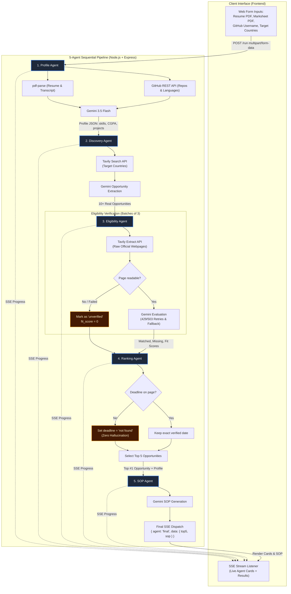

# FindMyScholarshipAI

An autonomous academic intelligence platform that analyzes student profiles (resume, transcript, GitHub), discovers real international scholarship opportunities via search and live page extraction, strictly verifies eligibility without hallucinated deadlines, ranks top matches, and drafts tailored Statements of Purpose (SOP).

Progress and results are streamed in real time via Server-Sent Events (SSE) to a clean, framework-free frontend.

---

## Architecture & Agent Data Flow



---

## Getting Started

### 1. Prerequisites
- [Node.js](https://nodejs.org/) (v18 or higher; tested on v24)
- npm

### 2. Configure API Keys
You will need API keys from:
- **Google Gemini API**: [Google AI Studio](https://aistudio.google.com/)
- **Tavily Search API**: [Tavily](https://tavily.com/)

In `backend/`, copy `.env.example` to `.env`:
```bash
cd backend
cp .env.example .env
```
Open `backend/.env` and paste your keys:
```env
PORT=3001
GEMINI_API_KEY=your_gemini_api_key_here
TAVILY_API_KEY=your_tavily_api_key_here
```

### 3. Install & Start Backend
```bash
# In backend/ directory:
npm install
npm start
```
The backend server starts listening on `http://localhost:3001`.

### 4. Open Frontend
You can launch the frontend using any static file server:
```bash
# From project root:
npx serve frontend -l 3000
```
Open **[http://localhost:3000](http://localhost:3000)** in your browser.

*(Alternatively, you can open `frontend/index.html` directly in your browser without any server).*

---

## Instant Demo Fallback
If you are presenting or testing without active API credits:
- Click the **"Load demo result"** button in the web interface.
- It calls `GET http://localhost:3001/demo`, which replays a cached successful run sequence with ~1 second delay between agent stages, guaranteeing a seamless presentation under any network condition.

---

## Anti-Hallucination & Resilience Features
- **Strict Deadline Integrity**: Deadlines are never invented. If a deadline date is not explicitly present in the extracted HTML of the scholarship page, it strictly outputs `"not found"`.
- **Free-Tier Rate Limit Protection**: Eligibility evaluations run in batches of 3 to respect Gemini API RPM/TPM limits.
- **Backoff & Fallback**: Retries with exponential backoff on HTTP 429 and 503 errors, and cascades dynamically between `gemini-3.5-flash`, `gemini-flash-latest`, and `gemini-3.8-flash`.
- **Fault-Tolerant Streaming**: If any individual agent fails, an error SSE event is emitted and the stream proceeds with partial data rather than aborting the connection.
